# 🌌 Awesome Neural Radiance Fields &amp; 3D Reconstruction

  <strong>Curated ecosystem of SaaS tools, cutting-edge AI spatial models, and high-performance open-source libraries for 3D Gaussian Splatting (3DGS), NeRFs, photogrammetry, and real-time WebGPU splat rendering.</strong>

  
  
  
  
  
  

---

## 📑 Table of Contents
- [✨ Sector Overview &amp; Market Dynamics](#-sector-overview--market-dynamics)
- [🏢 SaaS &amp; Commercial Platforms](#-saas--commercial-platforms)
- [💻 Open-Source GitHub Projects](#-open-source-github-projects)
- [🛠️ Additional Strong Open-Source Tools](#️-additional-strong-open-source-tools)
- [🤝 How to Contribute](#-how-to-contribute)
- [💖 Support &amp; Sponsor](#-support--sponsor)
- [📈 Star History](#-star-history)
- [⚖️ Disclaimer](#️-disclaimer)

---

## ✨ Sector Overview &amp; Market Dynamics

The global **3D reconstruction and neural rendering market** is projected to grow from **$1.18 billion in 2026** to over **$2.5 billion by 2032** at an estimated **CAGR of 9.2%–11.4%**, catalyzed by the rapid enterprise transition from slow coordinate-based implicit fields (NeRFs) to explicit **3D Gaussian Splatting (3DGS)** and real-time volumetric streaming.

Market dynamics currently exhibit a **moderately fragmented sector** where foundational capture pipelines (drones, phones, LiDAR) coexist with specialized cloud spatial engines; however, capital concentration is rapidly accelerating toward foundation spatial intelligence leaders (e.g., World Labs, Luma AI, Niantic) competing for winner-take-most dominance in enterprise spatial compute and generative 3D environments.

---

## 🏢 SaaS &amp; Commercial Platforms

The following SaaS and hosted commercial platforms are ranked and sorted in descending order by **Company Valuation / Annual Revenue**:

| 🏢 Platform | 💰 Valuation / Revenue | 💳 Starting Paid Tier | 🎁 Free Tier Limits | 📝 Description |
| :--- | :--- | :--- | :--- | :--- |
| **[World Labs](https://worldlabs.ai)** | **$5.4B Valuation** ($1B+ raised) | Enterprise pilot licensing | Free interactive web sandbox preview &amp; developer waitlist access with community demo credits | Spatial intelligence foundation platform founded by Fei-Fei Li generating persistent, interactive 3D worlds from photos and prompts. |
| **[Luma AI](https://lumalabs.ai)** | **$4.0B Valuation** (~$8M+ ARR) | **$30.00 / month** (Plus Plan) | 80 credits / day reset (1 basic generation/day), non-commercial use, 720p watermarked video exports | Cloud 3D capture and generative spatial intelligence platform turning mobile videos into interactive NeRFs, 3DGS, and simulations. |
| **[Scaniverse (Niantic)](https://scaniverse.com)** | **$250M Valuation** (Niantic division) | **$20.00 / month** (Plus Plan) | Unlimited on-device LiDAR &amp; 3DGS processing, basic cloud trial credits, non-commercial personal use | On-device mobile 3D Gaussian Splatting and photogrammetry application backing Niantic's persistent real-world AR spatial map. |
| **[Polycam](https://poly.cam)** | **$150M Valuation** (~$6.5M ARR) | **$12.50 / month** ($150 billed annually, or $30/mo) | Unlimited standard mobile LiDAR/photo captures, limited to GLTF web exports &amp; public web links only | Industry standard cross-platform 3D capture and cloud photogrammetry suite featuring Gaussian Splatting, mesh editing, and web sharing. |
| **[Varjo Teleport](https://varjo.com)** | **$150M Valuation** (~$30M ARR) | Enterprise seat licensing (~€120/seat/mo) | 14-day free trial on Varjo Reality Cloud with sample dataset processing and web viewer access | Industrial-grade spatial capture and cloud photogrammetry platform engineered for ultra-high-fidelity VR digital twins and defense. |
| **[Spline 3DGS Cloud](https://spline.design)** | **$80M Valuation** (~$4M ARR) | **$12.00 / month** ($144 billed annually, or $15/mo) | Unlimited personal files, 1,000 AI generation credits, basic web exports with Spline logo watermark | Collaborative browser-based 3D workspace supporting Gaussian Splat import, interactive physics, shaders, and web publishing. |
| **[Artec Cloud](https://artec3d.com)** | **$28M Annual Revenue** (Hardware/Cloud) | **$58.33 / month** ($700/yr for 200 GB cloud tier) | 30-day free trial with 5 GB cloud storage and collaborative scan inspection viewing | Enterprise browser-based 3D scan processing, metrology inspection, and collaborative mesh editing platform for handheld 3D scanners. |
| **[KIRI Engine](https://kiriengine.app)** | **$15M Valuation** (~$1.8M ARR) | **$6.66 / month** ($79.99 billed annually, or $17.99/mo) | Unlimited standard photogrammetry exports (OBJ/FBX/STL) with photo upload cap up to 150 photos/scan; 3DGS locked to Pro | Cloud 3D scanning app offering mobile photogrammetry, 3D Gaussian Splatting, PBR texture generation, and auto quad-remeshing. |
| **[Jawset Postshot](https://jawset.com)** | **$8M Valuation** (Boutique VFX studio) | **€17.00 / month** (~$19/mo, €204 billed annually) | Unlimited image count, video length, &amp; model size up to 4K SDR color; strictly non-commercial use with watermarks | Professional GPU-accelerated desktop radiance field studio specializing in fast 3D Gaussian Splatting training and Unreal Engine plugins. |
| **[Gracia AI](https://gracia.ai)** | **$5M Valuation** (Early-stage venture) | Enterprise project licensing (~$749/project starting) | Free web demo viewer access with sample 6DoF volumetric Gaussian Splat experiences | Spatial computing and volumetric 4D Gaussian Splatting platform streaming photorealistic 6DoF capture to VR headsets and browsers. |

---

## 💻 Open-Source GitHub Projects

The leading open-source repositories for Neural Radiance Fields, 3D Gaussian Splatting, and photogrammetry, ranked and sorted in descending order by **GitHub Stars_Count**:

| 📦 Repository &amp; Stars_Badge | ⭐ GitHub_Stars | 🛠️ Core Focus &amp; Architecture | 💡 Key Highlights |
| :--- | :--- | :--- | :--- |
| **[gaussian-splatting](https://github.com/graphdeco-inria/gaussian-splatting)**  | **24,555** | Original 3D Gaussian Splatting Reference Implementation (CUDA / C++ / PyTorch) | Landmark CVPR 2023 paper implementation enabling real-time radiance field rendering at 1080p without neural network evaluation during inference. |
| **[instant-ngp](https://github.com/NVlabs/instant-ngp)**  | **17,604** | Instant Neural Graphics Primitives with Multiresolution Hash Encoding (NVIDIA CUDA) | Groundbreaking NVIDIA framework training high-fidelity NeRF, signed distance functions (SDF), and neural gigapixel images in under 5 seconds. |
| **[colmap](https://github.com/colmap/colmap)**  | **13,294** | Structure-from-Motion (SfM) &amp; Multi-View Stereo (MVS) Pipeline (C++) | The universal gold standard camera pose estimation and sparse/dense point cloud generation framework underpinning NeRF and 3DGS workflows. |
| **[Meshroom](https://github.com/alicevision/Meshroom)**  | **13,115** | Node-Based 3D Reconstruction Software (AliceVision Photogrammetric Engine) | Accessible open-source desktop software providing an intuitive visual node graph to convert image collections into textured 3D meshes. |
| **[nerfstudio](https://github.com/nerfstudio-project/nerfstudio)**  | **12,260** | Modular NeRF &amp; 3DGS Framework (PyTorch / Web Viewer) | Premier modular developer framework featuring `Splatfacto`, custom dataset loaders, instant browser-based interactive viewers, and export pipelines. |
| **[nerf](https://github.com/bmild/nerf)**  | **10,958** | Original Neural Radiance Fields Paper (ECCV 2020 / TensorFlow) | The historic foundation paper that initiated the neural rendering revolution by synthesizing novel views of complex scenes using 5D neural radiance fields. |
| **[supersplat](https://github.com/playcanvas/supersplat)**  | **10,729** | Browser-Based 3D Gaussian Splat Editor &amp; Viewer (PlayCanvas / WebGL / WebGPU) | High-performance in-browser splat editor for cropping, orienting, denoising, and compressing raw `.ply` captures into lightweight `.sog` / `.splat` files. |
| **[stable-dreamfusion](https://github.com/ashawkey/stable-dreamfusion)**  | **8,884** | Text-to-3D &amp; Image-to-3D Synthesis (PyTorch / Stable Diffusion) | PyTorch implementation of DreamFusion using 2D Diffusion priors for text-to-3D NeRF generation and 3D Gaussian Splatting optimization. |
| **[dust3r](https://github.com/naver/dust3r)**  | **7,391** | Dense Unconstrained Stereo 3D Reconstruction (Vision Transformers / CroCo) | Revolutionary feed-forward stereo vision transformer inferring point maps, depths, and camera geometry from uncalibrated image pairs in seconds. |
| **[openMVG](https://github.com/openMVG/openMVG)**  | **6,609** | Open Multiple View Geometry Library (C++11) | Lightweight, accurate, and proven C++ library for Multiple View Geometry and Structure-from-Motion benchmarks. |
| **[nerf-pytorch](https://github.com/yenchenlin/nerf-pytorch)**  | **6,060** | PyTorch Implementation of NeRF | Clean, faithful, and readable PyTorch implementation of Neural Radiance Fields that educated thousands of CV researchers worldwide. |
| **[gsplat](https://github.com/nerfstudio-project/gsplat)**  | **5,955** | Differentiable Rasterization of 3D Gaussians (CUDA / PyTorch) | Ultra-fast, memory-efficient CUDA rasterization library with forward/backward passes powering modern training pipelines including Nerfstudio. |
| **[meshlab](https://github.com/cnr-isti-vclab/meshlab)**  | **5,941** | 3D Mesh &amp; Point Cloud Processing System (C++ / Qt) | The open-source standard software for cleaning, filtering, inspecting, rendering, and converting unorganized 3D meshes and point clouds. |
| **[brush](https://github.com/ArthurBrussee/brush)**  | **5,389** | Universal 3D Reconstruction Engine (Rust / WebGPU / Burn) | Next-generation cross-platform 3D reconstruction engine training 3D Gaussian Splats on NVIDIA, AMD, Apple Silicon, and WebGPU in browsers. |
| **[CloudCompare](https://github.com/CloudCompare/CloudCompare)**  | **4,891** | 3D Point Cloud Processing &amp; Mesh Comparison (C++) | High-performance open-source 3D point cloud editor supporting ICP registration, surface distance computation, segmentation, and rasterization. |
| **[openMVS](https://github.com/cdcseacave/openMVS)**  | **4,311** | Open Multi-View Stereo Reconstruction Library (C++) | Complete photogrammetric dense point-cloud reconstruction, mesh generation, mesh refinement, and texture mapping pipeline. |
| **[4DGaussians](https://github.com/hustvl/4DGaussians)**  | **4,045** | 4D Gaussian Splatting for Dynamic Scenes (CVPR 2024 / PyTorch) | Extension of 3DGS integrating temporal deformation fields to reconstruct complex dynamic scenes in real time with high rendering quality. |
| **[SuGaR](https://github.com/Anttwo/SuGaR)**  | **3,577** | Surface-Aligned 3D Gaussian Splatting (CVPR 2024 / PyTorch) | Method regularizing Gaussians to conform to scene surfaces, allowing fast Poisson mesh extraction and physics-driven mesh editing. |
| **[mast3r](https://github.com/naver/mast3r)**  | **3,177** | Matching &amp; Stereo 3D Reconstruction (NAVER Labs Europe) | Advancing DUSt3R with explicit local feature matching heads to recover accurate 6DoF camera poses and dense geometry in milliseconds. |
| **[GaussianSplats3D](https://github.com/mkkellogg/GaussianSplats3D)**  | **2,984** | Three.js 3D Gaussian Splatting Viewer (WebGL / JavaScript) | Optimized Three.js implementation providing smooth 60fps web rendering for `.ply`, `.splat`, and progressive `.ksplat` format files. |
| **[glomap](https://github.com/colmap/glomap)**  | **2,346** | Global Structure-from-Motion Mapper (C++ / COLMAP Team) | High-speed global SfM mapper computing rotation and translation globally, speeding up camera pose estimation by orders of magnitude over incremental SfM. |
| **[OpenSplat](https://github.com/WebODM/OpenSplat)**  | **2,274** | Multi-Platform 3D Gaussian Splatting Implementation (C++) | Open-source standalone C++ implementation supporting Apple Metal (macOS), AMD ROCm, NVIDIA CUDA, and CPU execution without heavy Python dependencies. |
| **[mip-splatting](https://github.com/autonomousvision/mip-splatting)**  | **1,491** | Alias-Free 3D Gaussian Splatting (CVPR 2024) | Introduces 3D smoothing filters and 2D dilation filters to eliminate high-frequency aliasing and dilation artifacts across varying camera distances. |
| **[spz](https://github.com/nianticlabs/spz)**  | **948** | Ultra-Compressed Gaussian Splat Format (Niantic Spatial / C++ / Python) | Efficient open-source compression library packing 3D Gaussian Splats into gzip-compressed `.spz` files that are ~10x smaller than raw `.ply`. |

---

## 🛠️ Additional Strong Open-Source Tools

- 🔍 **[GLOMAP](https://github.com/colmap/glomap)**: Global SfM for ultra-fast camera calibration on multi-thousand image drone datasets.
- 📐 **[VGGT](https://github.com/apple/ml-vggt)**: Feed-forward visual geometry grounding transformers inferring poses and 3D maps without explicit feature matching.
- 📦 **[Mini-Splatting](https://github.com)**: Aggressive splat pruning reducing GPU VRAM consumption and download sizes by up to 80% without fidelity loss.
- 🎮 **[Spz-ThreeJS](https://github.com)** &amp; **[LichtFeld Studio](https://github.com)**: Native C++/CUDA and WebGPU streaming runners for spatial computing and interactive web viewports.

---

## 🤝 How to Contribute

Contributions are warmly welcomed! Help keep this repository the authoritative index for 3D vision:

1. 🍴 **Fork the repo** to your GitHub account.
2. 🌿 **Create a branch** for your feature or additions (`git checkout -b feature/add-tool`).
3. 📝 **Add entries** following the tabular format with factual pricing, free-tier limits, and Stars_Badges.
4. 🚀 **Submit a Pull Request** with a brief summary of the added software or repository.

---

## 💖 Support &amp; Sponsor

If you find this curated collection valuable for your research, graphics pipeline, or commercial projects, please consider supporting the project:

- ⭐ **Star this repository** to help other researchers and developers discover it!
- 🍴 **Fork and share** the repo with your colleagues in computer vision and VFX.
- ☕ **Buy me a coffee**: Support ongoing curation and open-source tooling via the **[GitHub Sponsors Dashboard](https://github.com/sponsors/ishandutta2007)**!

Thank you to all contributors and sponsors for keeping the 3D vision and spatial computing ecosystem vibrant and open! 🚀

---

## 📈 Star History

---

## ⚖️ Disclaimer

- This curated list is maintained for educational and reference purposes only and does not constitute an endorsement.
- Training NeRFs and 3D Gaussian Splats locally typically requires a dedicated GPU with sufficient VRAM (8 GB–24 GB+) or Apple Silicon unified memory. Raw `.ply` splat files can exceed hundreds of megabytes unless compressed into modern `.spz`, `.sog`, or `.ksplat` formats prior to web distribution.
